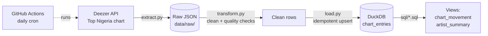

# 🇳🇬 Naija Chart Pipeline

A daily batch **ETL pipeline** that tracks the official Deezer *Top Nigeria* chart, cleans it, stores it in a SQL warehouse, and models chart movement and artist dominance over time.

## Architecture



## What this project demonstrates
| Skill | Where |
|---|---|
| API extraction with pagination | `pipeline/extract.py` |
| Raw data lake layer (replayable) | `data/raw/` |
| Data cleaning and quality checks | `pipeline/transform.py` |
| Idempotent loading (safe re-runs) | `pipeline/load.py` |
| SQL modelling with window functions (`LAG`) | `sql/` |
| Unit tests | `tests/` |
| Scheduling / orchestration (free) | `.github/workflows/daily.yml` |

## Run it locally
```bash
python -m venv .venv && source .venv/bin/activate
pip install -r requirements.txt
pytest -q
python run_pipeline.py
```

## Example questions it answers
```sql
-- Biggest climbers today
SELECT * FROM chart_movement
WHERE chart_date = CURRENT_DATE ORDER BY places_gained DESC LIMIT 10;

-- Artists with the most songs on the chart
SELECT * FROM artist_summary LIMIT 10;
```

## Next steps
- Add a Streamlit dashboard on top of DuckDB
- Add YouTube view counts for each charting song
- Move the warehouse to BigQuery's free tier and model it with dbt
